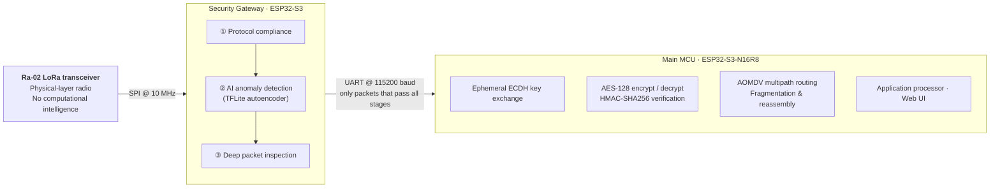

<h1 align="center">AEGIS-LN</h1>

<b>Mesh of Trust, Shield of AI</b> 
A hardware-isolated, AI-protected LoRa mesh for secure off-grid communication.

  
  
  

> **About this repository.** This is the public overview of AEGIS-LN, a final-year team project for the
> BS Cyber Security at Air University, Islamabad. The source code, firmware and datasets are
> **private** while the associated research is under publication. This page describes the
> problem, the architecture, the security design and the results at a level that is safe to publish.

---

## The problem
Tactical, industrial and emergency communications increasingly move off-grid, and in doing so they leave
behind the protection of traditional ISP infrastructure. Standard IoT and mesh networks are prime targets for
**eavesdropping**, **routing poisoning** and **denial-of-service** attacks.

> *How do we deploy secure, reliable and affordable communication in disaster zones and tactical environments
> without any pre-existing infrastructure, and ensure the network cannot be crippled by cyberattacks,
> routing poisoning or malicious nodes?*

## The approach
AEGIS-LN is a decentralized, off-grid LoRa mesh built on a strict **default-deny, zero-trust** philosophy:

- **Zero infrastructure:** instant mesh communication with no dependence on cellular networks or the internet.
- **Strong, efficient cryptography:** ephemeral ECDH key agreement for forward secrecy, AES-128 encryption and Encrypt-then-MAC authentication.
- **Edge-AI protection:** a physically isolated, 3-stage TensorFlow Lite firewall inspects every packet before it reaches the node's application processor.

## Architecture: tri-component secure node
Each node splits radio, inspection and cryptography across three physically separate components, so that
compromising one does not expose the others.

| Component | Role | Deliberately cannot |
|---|---|---|
| **Ra-02 LoRa transceiver** | Physical-layer radio | Run any logic |
| **Security Gateway** (ESP32-S3) | Inspects every inbound packet through the 3-stage AI firewall | Access cryptographic keys |
| **Main MCU** (ESP32-S3-N16R8) | Key exchange, encryption, authentication, routing, application and Web UI | Access the radio directly |

**Design principles:** least privilege · defense in depth · resource isolation · default deny.

## Security design

### Cryptography
- **Key agreement:** **ephemeral ECDH** per session, so captured traffic cannot be decrypted later even if a node is compromised (forward secrecy).
- **Authenticated encryption:** **AES-128-CBC** with a fresh random IV per message, combined with **HMAC-SHA256** in an
  **Encrypt-then-MAC** construction. The tag covers the packet header, IV and ciphertext, and it is verified
  (in constant time) **before** any decryption, so tampered or forged packets are rejected without ever reaching the decryptor.
- **Why AES-CBC + HMAC rather than AES-GCM or ChaCha20-Poly1305:** both primitives are hardware-accelerated on the
  ESP32-S3 and natively supported by mbedTLS. Composed as Encrypt-then-MAC with independent keys, they provide authenticated
  encryption with well-understood security properties at under 2 ms per operation, and they avoid GCM's catastrophic
  failure mode under nonce reuse on constrained devices.

### Replay protection
Every packet carries a **per-session, monotonically increasing sequence number** inside the authenticated header.
Receivers track the highest accepted sequence number per peer and **drop duplicate or stale packets**. Because session
keys are ephemeral, traffic captured from an earlier session fails authentication outright.

### AI firewall (Security Gateway)

| Stage | What it does |
|---|---|
| **① Protocol compliance** | Default-deny parsing: malformed, oversized or out-of-spec frames and routing messages are dropped immediately |
| **② AI anomaly detection** | A TensorFlow Lite autoencoder scores traffic behavior; packets with abnormal reconstruction error are blocked |
| **③ Deep packet inspection** | Inspects packet contents for known attack patterns before anything is forwarded to the Main MCU |

## Threat model (summary)

| Threat | Mitigation |
|---|---|
| Eavesdropping on radio traffic | AES-128 encryption under ephemeral ECDH session keys |
| Tampering or forgery | Encrypt-then-MAC with HMAC-SHA256, verified before decryption |
| Replay attacks | Authenticated per-session sequence numbers; ephemeral keys invalidate old captures |
| Routing poisoning (malformed or forged route requests) | Protocol-compliance stage + anomaly detection before packets reach AOMDV routing |
| DoS floods | Dropped at the Security Gateway, keeping the Main MCU and routing table unaffected |
| Compromise of the inspection component | Hardware isolation: the gateway holds no keys and has no access to the application processor |
| Long-term key compromise | Forward secrecy from ephemeral ECDH |
| Loss of nodes or paths | AOMDV keeps multiple loop-free backup paths, so traffic fails over without new route discovery |

## Results
Measured on a hardware testbed with simulated attack traffic.

| Metric | Result |
|---|---|
| Anomalous traffic detected and dropped (DoS floods, malformed routing requests) | **> 96 %** |
| False-positive rate | **< 2 %** |
| AI firewall latency per packet (all 3 stages) | **7–15 ms** |
| Hardware-accelerated Encrypt-then-MAC operation | **< 2.0 ms** |

## Limitations & future work
- Results come from simulated attack traffic on a lab testbed. Field-scale, multi-hop evaluation is ongoing work.
- Planned: benchmarking AEAD alternatives (AES-GCM, ChaCha20-Poly1305), certificate-based node identity provisioning, and
  delay-tolerant (DTN) store-and-forward for disaster-resilient deployments.

## My role
- **Secure communication layer:** designed and implemented ephemeral ECDH key exchange and AES-128 Encrypt-then-MAC (HMAC-SHA256) on the Main MCU using mbedTLS, including replay protection with authenticated sequence numbers.
- **Edge-AI firewall:** trained and quantized the TensorFlow Lite autoencoder for the Security Gateway and integrated it with the protocol-compliance and deep-packet-inspection stages.
- **Threat modeling & evaluation:** modeled the attack surface (eavesdropping, routing poisoning, DoS, replay) and built the simulated attack traffic used to measure detection rate, false positives and latency.
- **Monitoring:** built the real-time dashboard that visualizes node health and threats across the mesh.
- **Research:** co-authored the resulting IEEE IBCAST 2026 paper.

## Technology
`ESP32-S3` `ESP32-S3-N16R8` `Ra-02 LoRa (SX1278)` `C++` `Python` `mbedTLS` `TensorFlow Lite` `Autoencoders` `Deep Packet Inspection` `AOMDV` `ECDH` `AES-128` `HMAC-SHA256` `SPI` `UART`

## Research
- **IEEE IBCAST 2026** *(conditionally accepted, pending reviewer revisions and camera-ready submission)*:
  *Hardware-Isolated Secure Mesh Communication with Edge-AI Intrusion Detection over LoRa* (co-author).
- A related international (Pakistan–Sri Lanka) grant proposal on ML-driven intrusion detection and secure DTN LoRa communication is **under review**.

## Acknowledgements
Developed as a final-year team project at the Department of Cyber Security, Air University, Islamabad, under faculty supervision.

## Access
The source code is not public. For research collaboration or evaluation access, contact me via
[LinkedIn](https://www.linkedin.com/in/muhammadtalha-cybersecurity).

---
© 2026 Muhammad Talha. All rights reserved. No license is granted for the design or the private implementation.
